# Kids World

A home screen for Android TV made for children, built on the
[Clean Your TV](https://github.com/Gathin23/cleanyourtv) launcher. Children see four illustrated worlds with a mascot
and only the apps a parent allowed. Homework earns extra screen time: a child reports a task on the TV, a parent
confirms it on the phone, and the minutes are added.

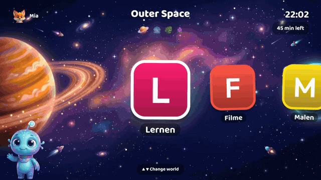

The app follows the TV's language: English, or German on a German TV. A parent can also fix the language in the parent area.

## Screenshots

| | |
|---|---|
| 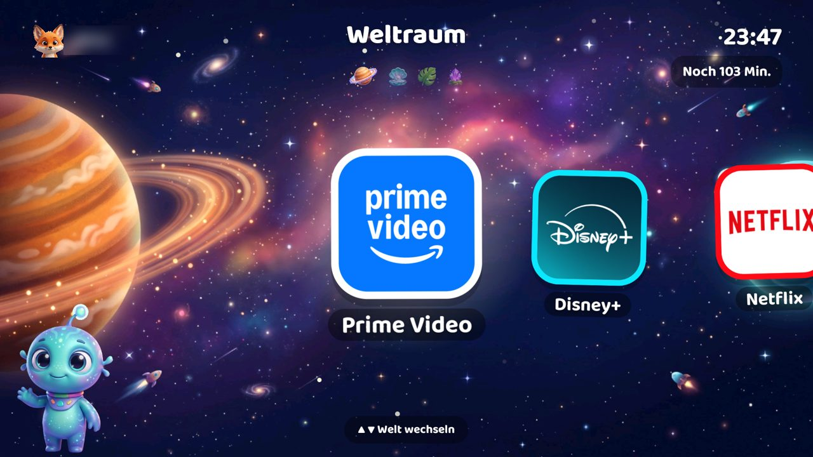 | 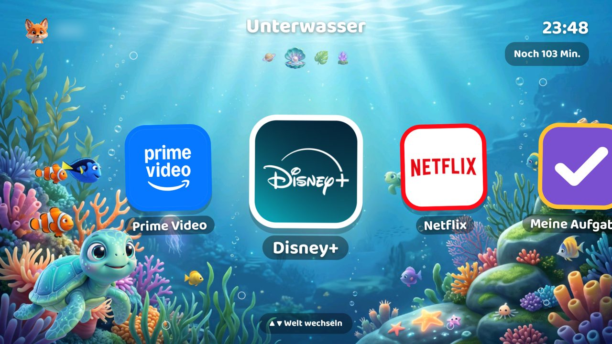 |
| 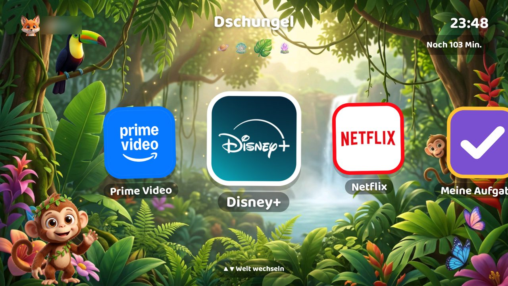 | 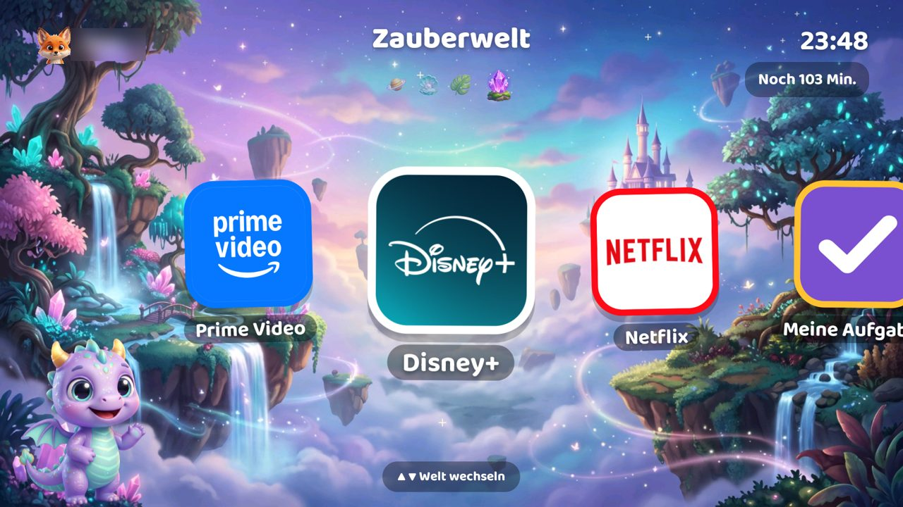 |
| 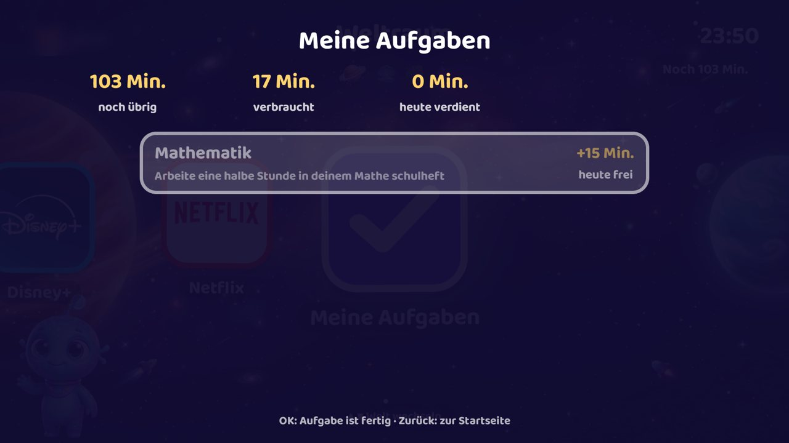 | 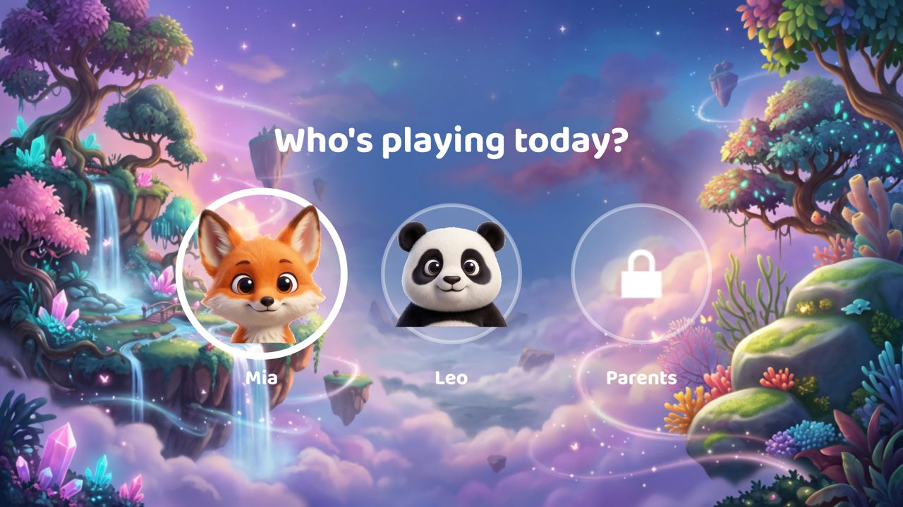 |
| 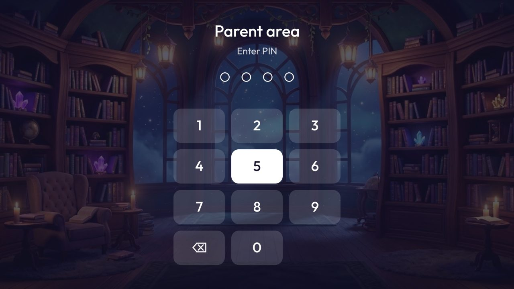 | 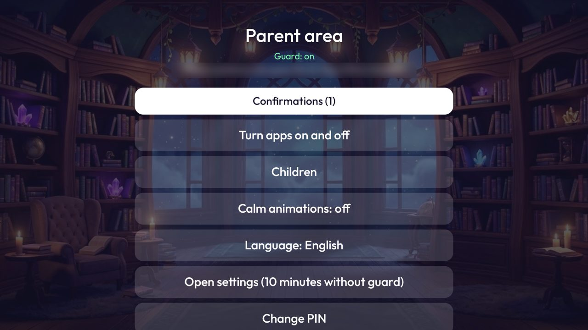 |
| 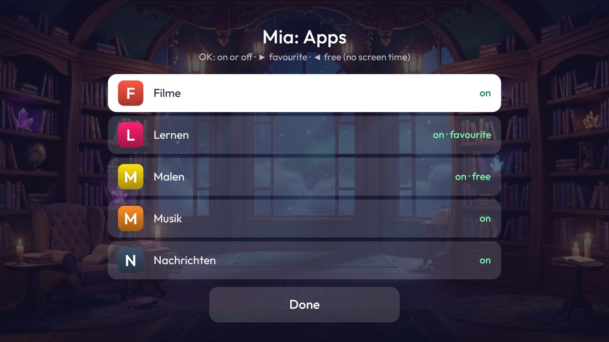 | 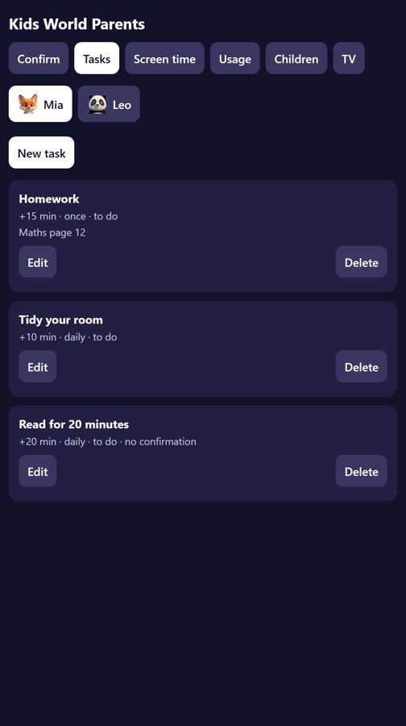 |
| 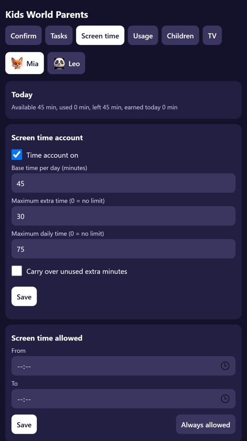 | |

The GIF and the world and task pictures come from a waipu tv stick. The parent area, profile and phone pictures come from the emulator with sample data. Child names and the network address are blurred.

## What it does

- Child profiles, each with its own allowed apps and favourites.
- Daily screen time, bedtime and a parent PIN.
- Tasks: one-off or on chosen weekdays, with extra minutes and optional parent confirmation. Credits are stored once
  per task and day, and the daily maximum is never exceeded.
- Apps that count against screen time, or apps a parent marks as free.
- A web page for the parent's phone on the home network (port 8686): confirm tasks, change time, see usage, send a
  message to the TV. A phone pairs once with a code shown on the TV.

## Requirements

- Android TV 8.0 or newer (API 26). Tested only on the devices listed under "Tested on".
- ADB access to the TV for the first setup.
- To build: JDK 17 and the Android SDK with platform 34.
- For the phone page: TV and phone on the same network.

## Project structure

| Folder | What is in it |
|---|---|
| `app/` | The Android app and the code of the Clean Your TV launcher it is built on |
| `theme/` | The children's interface, pictures and fonts |
| `kidsmode/` | Rules, guard, parent area, database and the phone page |
| `media/` | Pictures for this page |
| `docs/` | Test sheet for the remote |

## Build

```sh
./gradlew testDebugUnitTest assembleRelease
```

The APK is `app/build/outputs/apk/release/app-release.apk`. The repository holds no APK and no signing key. Gradle signs
the build with your own local debug key, so an update must come from the same machine. For anything you pass on to
other people, set up your own release key.

## Install

```sh
adb connect <tv ip>:5555
adb install -r app/build/outputs/apk/release/app-release.apk
adb shell cmd package set-home-activity io.github.dariusquack.kidsworld/io.github.dariusquack.kidsworld.HomeActivity
adb shell settings put secure enabled_accessibility_services io.github.dariusquack.kidsworld/io.github.dariusquack.kidsworld.addon.kidsmode.KidsGuard
adb shell settings put secure accessibility_enabled 1
```

The accessibility line replaces the list of enabled services. Check the list first with
`adb shell settings get secure enabled_accessibility_services`. If it has entries, keep them, separated by `:`.

If the TV keeps its own launcher as Home, Kids World does not become the home screen. On some devices the stock launcher
must be turned off first, which `pm disable-user` can do where the firmware allows it.

Hold OK for 5 seconds on the home screen and choose a PIN. The phone address is shown in the parent area. Close network
ADB when you are done.

To remove it, run `adb uninstall io.github.dariusquack.kidsworld`. This deletes the PIN, tasks and time accounts.

## Permissions and background work

| Item | Why |
|---|---|
| `INTERNET` | Serves the parent page on the home network, port 8686. The code of this project connects to nothing on the internet. |
| Accessibility service `KidsGuard` | Sees which app is in front, sends the TV home for apps that are off, filters a few remote keys, counts screen time and shows messages. It does not read content inside apps. |
| `ACCESS_NETWORK_STATE`, `ACCESS_WIFI_STATE`, `ACCESS_FINE_LOCATION`, `WRITE_SECURE_SETTINGS`, `yandex.tv.permission.ACCESS_TV_SOURCE` | Inherited from the base launcher. `WRITE_SECURE_SETTINGS` works only if you grant it over ADB, and setup does not need it. |
| Services inherited from the base launcher | `HomeKeyService`, `InputKeyService`, `GuardRevival` and `ClockDream` are in the manifest. They stay inactive unless you turn them on. |

No accounts, telemetry, ads or analytics. Data stays on the TV.

## Limits

- This is a hurdle for children, not a guarantee. Android offers an app like this no system-wide lock.
- The phone page uses plain HTTP. See [SECURITY.md](SECURITY.md).
- A force-stop in Android's settings turns the guard off, and turning the setting back on is not enough: it runs again
  after the next reboot or reinstall. The parent area shows the real state, counted apps
  no longer start, the home screen asks for a parent, and the log records it once the guard is back. The phone page
  stops responding meanwhile.
- Time counts while a counted app is in front, including a paused video.
- A clock set back gives no new day. A clock set forward starts a new day, and that day then stays until the real date
  catches up. Settings stay behind the PIN for that reason.
- Removing the app deletes all its data.

## Tested on

- waipu tv stick (SEI700WP), Android 11: installation, cold start, phone page on a real phone, English and German.
- Android TV 11 emulator.

Remote keys, HDMI and live TV are still being tested with [this sheet](docs/REMOTE_TEST.md).

## Version

1.0.0, see [CHANGELOG.md](CHANGELOG.md).

## Licence and credits

MIT, see [LICENSE](LICENSE). Base launcher: [Clean Your TV](https://github.com/Gathin23/cleanyourtv) by Gathin, MIT.
Fonts: SIL Open Font License, see `FONT-LICENSE-OFL.txt` and `theme/FONT-LICENSE-Baloo2-OFL.txt`.
